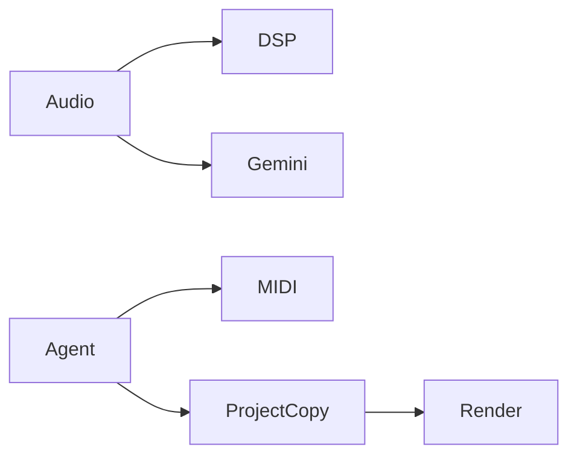

# Music Workbench MCP

**Give agents measurable audio evidence and controlled FL Studio workflows.**

[](https://github.com/ashutosh0sharma1/music-workbench-mcp/actions/workflows/ci.yml)

## What you can do

Local DSP, bounded Gemini listening, correlated MIDI calls, saved-project rendering and checkpoints.

## How it works



## Quick start

```sh
powershell -NoProfile -File install.ps1
runtime\.venv\Scripts\python.exe gemini_server.py
```

## Verify

```sh
runtime\.venv\Scripts\python.exe -m unittest test_gemini_server -v
```

[VALIDATION.md](VALIDATION.md) records checks actually run against this export and their limits.

## Boundaries

Windows-oriented: requires Git, Cargo, uv and a separately licensed FL Studio. Plugins/samples are not bundled. Rendering requires a saved project and a closed interactive FL session. Gemini uploads selected audio and may charge per call.

## Contribute

Start with a small synthetic reproduction. Improvements to portable setup, failure recovery, documentation and regression coverage are welcome. Read [CONTRIBUTING.md](CONTRIBUTING.md) before opening a pull request.

## License and provenance

See [LICENSE](LICENSE) and [THIRD_PARTY_NOTICES.md](THIRD_PARTY_NOTICES.md). This clean source export excludes private data, credentials and development history.

## Tool selection and FL setup

| Server | Entry point | Use |
|---|---|---|
| Local DSP | `runtime/audio-analyzer/mcp-server.exe` | Levels, spectrum, stereo, rhythm and harmonic measurements |
| Gemini listening | `runtime/.venv/Scripts/python.exe gemini_server.py` | Explicit perceptual feedback on a selected excerpt |
| Live FL bridge | `runtime/fl-venv/Scripts/python.exe fl_server.py` | Ping, readback and supported MIDI control |
| Saved-file workbench | `runtime/workbench-venv/Scripts/python.exe workbench_server.py` | New FLP copies, composition, checkpoints and rendering |

Configure your MCP client with the absolute executable and script paths for the selected server. Forward `GEMINI_API_KEY` only to the Gemini server through your local environment. A listening request uploads one selected file, capped at 12 MiB, with a 90-second timeout and no retries. Local DSP does not upload audio.

For live FL control, install the pinned upstream MIDI controller from `runtime/flstudio-mcp` into your actual FL user-data Settings directory following that upstream's setup instructions. Set `FLSTUDIO_MCP_DATA_DIR` to your FL user-data root. Install loopMIDI and create `FLStudioMCP RX`; enable that input in FL, choose the FLStudioMCP controller, and assign input and same-named output to port 42. This patched bridge uses the RX port in full duplex; a TX port is not used. Run one bridge process and require `fl_ping` to report alive before writing.

For saved projects, start with `workbench_status`, then `read_composition`. Write the complete modified object to a new absolute path, render with FL closed, and compare the output. Unsaved in-memory edits are outside that workflow. Override `FLSTUDIO_EXECUTABLE` when the executable is elsewhere.

After the installer completes, `python make_test_fixture.py` creates synthetic audio and `runtime/workbench-venv/Scripts/python.exe -m unittest test_workbench -v` checks byte preservation, checkpoint restoration and tamper rejection. Do not create the fixture before a fresh `install.ps1`, which deliberately refuses existing runtime directories.
